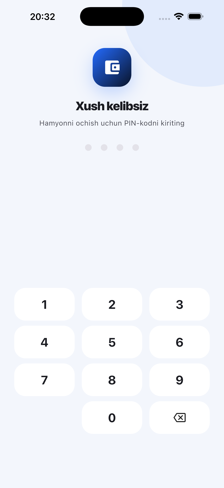
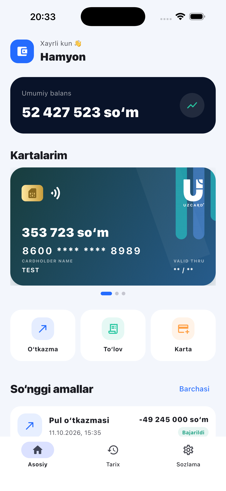
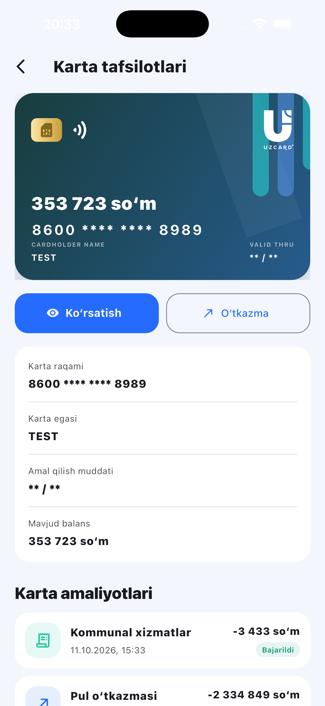
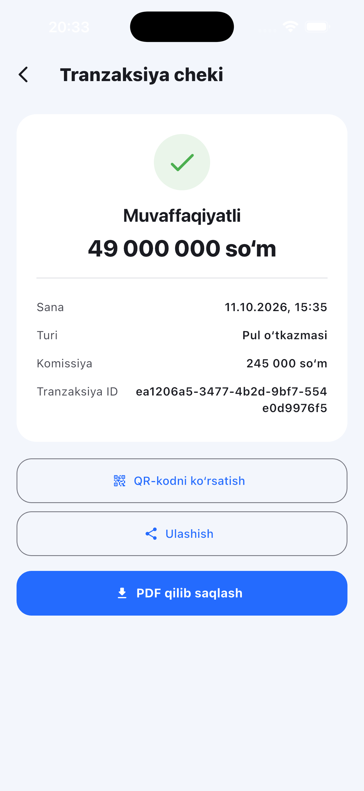
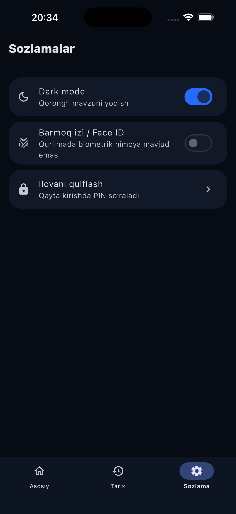
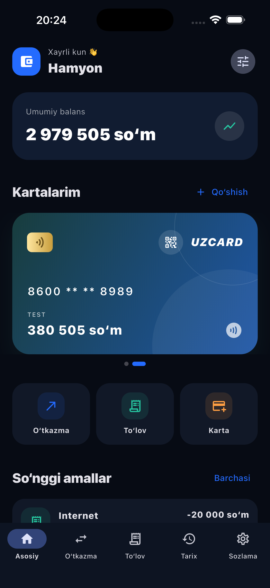

<div align="center">

# Hamyon

**Xavfsiz, local-first virtual hamyon — Flutter'da yaratilgan.**

[](https://flutter.dev)
[](https://dart.dev)


Hamyon — virtual kartalar, pul o'tkazmalari va kundalik to'lovlarni boshqarish uchun yaratilgan mobil demo ilova. U fintech interfeyslari, lokal ma'lumotlar xavfsizligi va Clean Architecture yondashuvini amaliy ko'rsatadi.

> Ilova haqiqiy bank tizimiga ulanmaydi va real pul bilan ishlamaydi.

</div>

## Ilova ko'rinishi

<table>
  <tr>
    <th>1. PIN orqali kirish</th>
    <th>2. Asosiy sahifa</th>
    <th>3. Karta tafsilotlari</th>
  </tr>
  <tr>
    <td></td>
    <td></td>
    <td></td>
  </tr>
  <tr>
    <th>4. Tranzaksiya cheki</th>
    <th>5. Sozlamalar</th>
    <th>6. Dark mode</th>
  </tr>
  <tr>
    <td></td>
    <td></td>
    <td></td>
  </tr>
</table>

## Nimalar qila oladi?

- UZCARD virtual kartalarini qo'shish va balansni boshqarish
- Kartalar o'rtasida 0.5% komissiya bilan pul o'tkazish
- Mobil aloqa, internet va kommunal xizmatlar uchun to'lov qilish
- Muvaffaqiyatli va rad etilgan tranzaksiyalar tarixini filtrlash
- Chekni QR-kodda ko'rsatish, PDF saqlash yoki ulashish
- PIN, Face ID yoki barmoq izi bilan himoyalanish
- Light va dark mavzulardan foydalanish

## Xavfsizlik

Ma'lumotlar qurilmaning o'zida saqlanadi. Vault `PBKDF2-HMAC-SHA256` asosidagi kalit, `AES-256-GCM` shifrlash va har bir tranzaksiya uchun `HMAC-SHA256` imzo bilan himoyalangan. Uchta noto'g'ri PIN urinishidan so'ng vaqtinchalik blok yoqiladi; ilova fonga o'tganda yoki ikki daqiqa faol bo'lmaganda avtomatik qulflanadi.

## Arxitektura

Loyiha feature-first Clean Architecture asosida tuzilgan:

```text
lib/
├── core/                 # Theme, security, utilities, shared widgets
└── features/
    ├── auth/             # Data / Domain / Presentation
    ├── cards/
    ├── transfer/
    ├── payments/
    ├── history/
    ├── receipt/
    ├── qr/
    ├── home/
    └── settings/
```

Har bir feature repository, use case va Cubit orqali ajratilgan. Pul qiymatlari aniqlikni saqlash uchun `double` emas, butun `int` so'm ko'rinishida yuritiladi.

## Ishga tushirish

```bash
flutter pub get
flutter run
```
